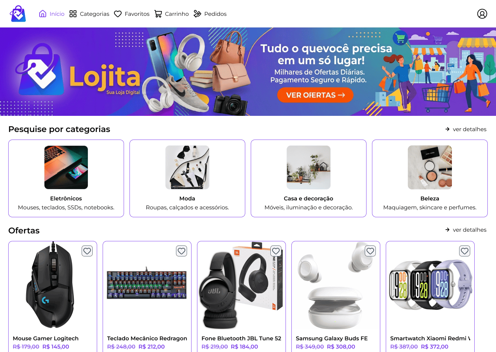
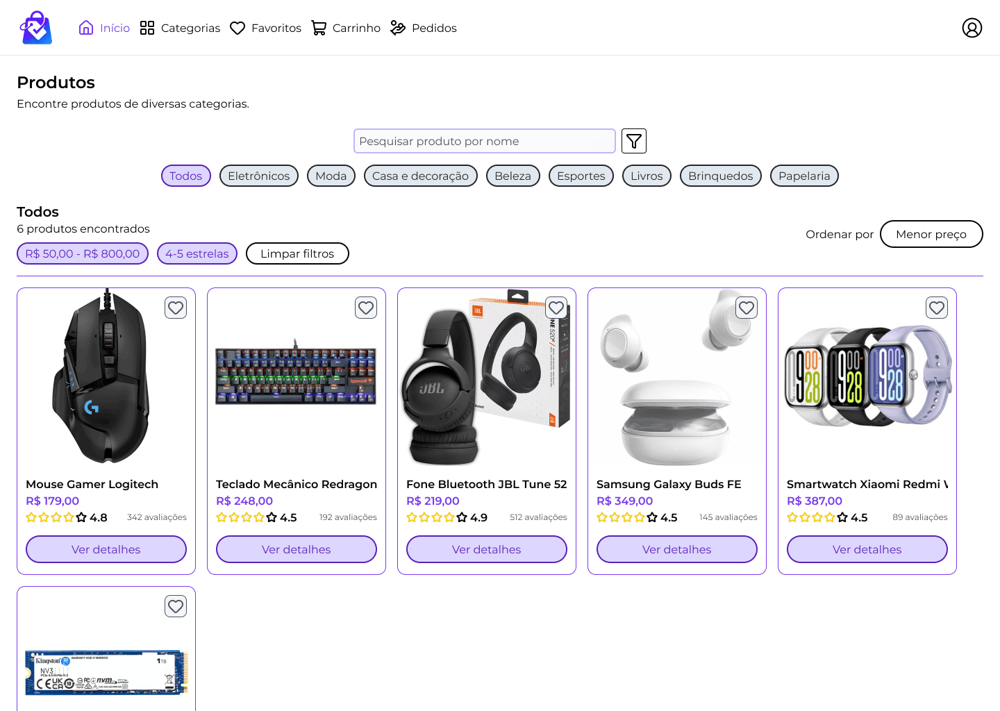
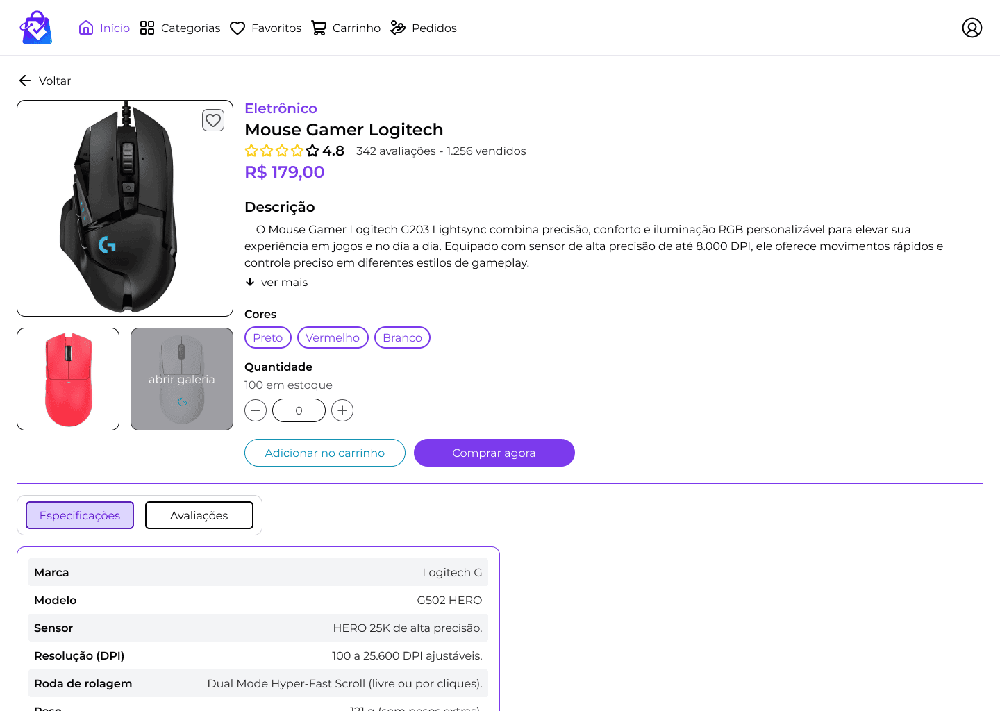
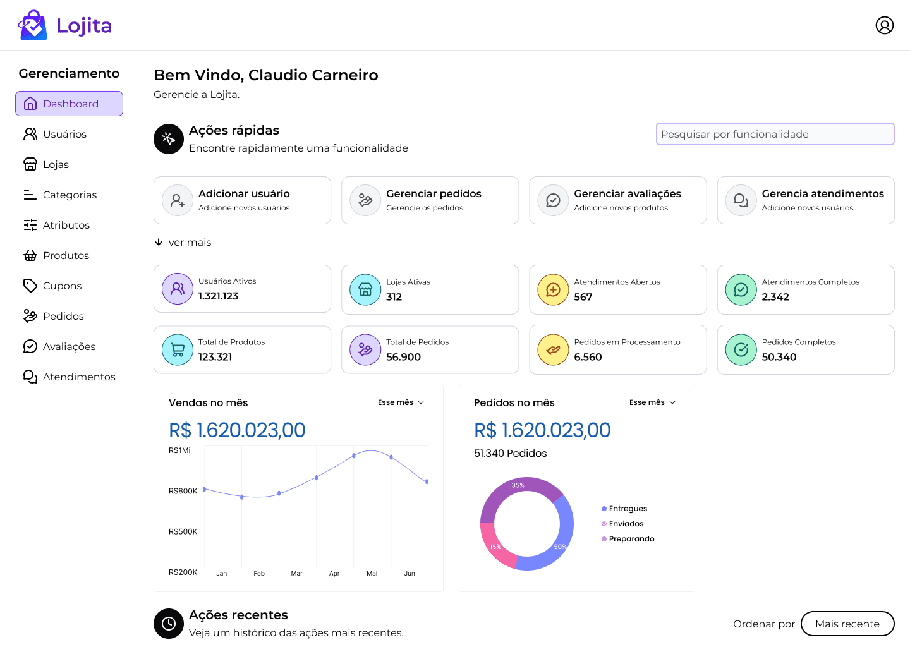
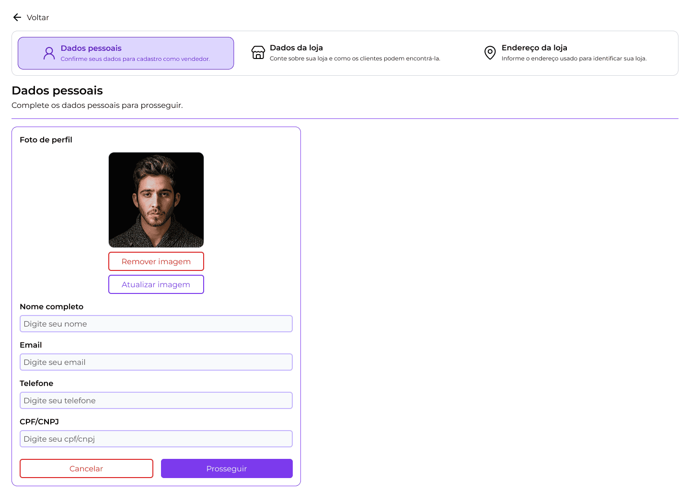

# Lojita

A multi-vendor marketplace for discovering products, shopping online, and managing stores in one place.

[Live demo](https://lojita.vercel.app) · [GitHub repository](https://github.com/cemgthedev/Lojita) · [Technical guide to routes and permissions](app/src/routes/guide.md)

## Showcase

These screenshots from the project show the customer, seller, and administrator experiences.











## Problem and goals

Small sellers need an online storefront and tools to manage their businesses, while shoppers need a convenient way to discover products from different stores. Lojita brings these experiences together and organizes the interface around user roles.

## Key features

- Public storefront with categories, deals, and catalog browsing.
- Product search, filtering, and sorting.
- Product details with images, variants, stock, reviews, and purchase actions.
- Customer, seller, and admin areas with role-specific navigation and routes.
- Seller registration flow and management screens for products, stores, and support.
- Authentication structure and HTTP integration with an environment-configured API.

> This project is the frontend application. Business operations, payments, and data authorization depend on the API; a client-side screen or route is not a substitute for server-side validation.

## Tech stack

- **Interface:** React 19, TypeScript 6, and Vite 8.
- **Styling and components:** Tailwind CSS 4, Radix UI, and custom components.
- **Routing and data:** React Router 7 and TanStack Query.
- **Forms and validation:** Zod.
- **Utilities:** date-fns, Lucide React, Embla Carousel, and Sonner.

## Architecture

The application code lives in `app/`. Pages, reusable components, API access, shared state, and route configuration are organized separately.

```text
app/src/
├── api/          HTTP requests and API resources
├── components/   UI components and role-specific layouts
├── pages/        customer, seller, admin, and support pages
├── providers/    authentication, query cache, and notifications
├── routes/       public and authenticated routes, role guards
└── styles/       global styles
```

In brief, `main.tsx` sets up the providers and router. Public and authenticated routes direct users to pages, while layouts and guards organize role-specific areas. Pages use modules in `api/` to communicate with the external service.

## Trade-offs

- **Routes grouped by role:** provide clearer layouts and permissions, but route definitions and navigation links must stay aligned.
- **Frontend separated from the API:** allows the interface to evolve independently, but requires `VITE_API_URL` and an available service for flows that rely on live data.
- **Client-side guards:** improve navigation and prevent inappropriate areas from being displayed, but are not a security boundary; the server must authorize every operation and resource.

## Results and lessons learned

The project brings together a visual product discovery and shopping experience with administrative interfaces for different roles. The modular structure of pages, API resources, and routes helps separate responsibilities; the key lesson is to keep authorization consistent across the interface, routes, and backend.

## Roadmap

- Publish a demo connected to an accessible environment.
- Complete and validate end-to-end flows with the API, including orders and payments.
- Add tests for the main navigation and shopping flows.
